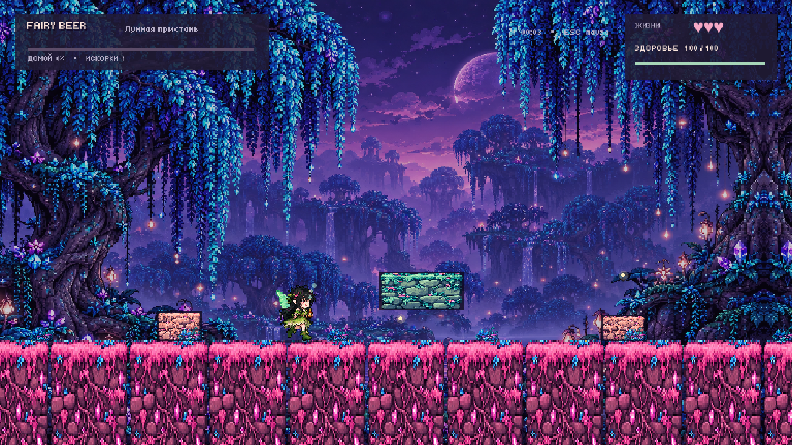
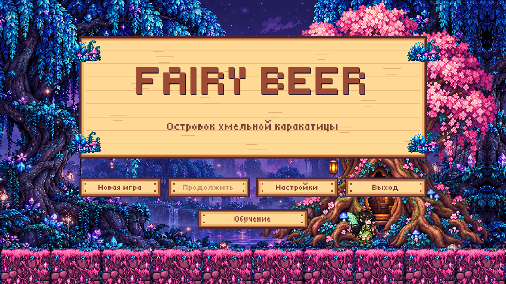

# Fairy Beer — платформер об освоении непривычного управления

**Лира должна успеть домой до рассвета.** На пути — остров с меняющимися препятствиями, враги и сова, которая наказывает за долгую остановку. Главный игровой приём — инвертированное управление: привычная реакция игрока сначала мешает, а затем становится освоенным навыком.

[⬇️ Скачать Windows-сборку 2.2.0](https://github.com/neonkitts/Probnyy-proekt-Unity/releases/tag/v2.2.0) · [🎮 Геймдизайнерский разбор](DESIGN_CASE_RU.md) · [📋 Механики](MECHANICS_RU.md) · [🖼️ Скриншоты](Portfolio)

## Игровой цикл

**Освоить правило → прочитать препятствие → выбрать действие → пройти участок → закрепить прогресс.**

- **Управление как испытание.** A/← ведёт вправо, D/→ — влево; S/↓ отвечает за прыжок, W/↑ — за приседание. Обучение объясняет правила до сложных участков.
- **Маршрут с вариативностью.** Новый seed меняет размещение препятствий; сохранённый seed воспроизводит тот же маршрут. Безопасные зоны не дают генерации превратиться в случайную ловушку.
- **Давление без постоянной спешки.** Лозы и птеродактили создают локальные угрозы. После более четырёх секунд бездействия на земле сова предупреждает игрока и атакует место остановки.
- **Право на ошибку.** Три жизни, здоровье, контрольные точки и сохранение помогают учиться через повторение.

[В разборе](DESIGN_CASE_RU.md) описаны цель механик, структура обучения, риски баланса и критерии следующего плейтеста.

## Запуск

Игра доступна для **Windows x64**. Скачайте [FairyBeer-Windows.zip](https://github.com/neonkitts/Probnyy-proekt-Unity/releases/tag/v2.2.0), распакуйте архив целиком и запустите `FairyBeer.exe`. Unity для игры не нужна.

Чтобы открыть проект в редакторе, используйте Unity **6000.4.7f1** и сцену [Island.unity](Assets/Scenes/Island.unity). В редакторе доступны `Chibi → Validate generation and gameplay` и `Chibi → Build Windows game`.

## Статус и проверка

Версия **2.2.0**. [Журнал QA](QA/validation.txt) фиксирует 113 936 автоматических проверок на 100 seed: генерацию, инверсию ввода, движение, прыжки и столкновения. Windows-сборка запускалась; ускоренный автотест дошёл до финала. Полное ручное прохождение и физический геймпад ещё требуют проверки. Оценка длительности маршрута — около 20 минут, не результат плейтеста.

## Мой вклад

Я сформулировала концепцию, требования к механикам и визуальному направлению, подбирала референсы, проверяла результат и давала обратную связь. Код, исправления, проверки и часть материалов создавались **с помощью Codex**. Проект показывает работу с игровой идеей, правилами и итерациями; он не заявляется как самостоятельно написанный коммерческий продукт.

Ключевой код: [игровая логика](Assets/Scripts/ChibiGame.cs), [представление и обучение](Assets/Scripts/ChibiPresentation.cs), [сборка и проверки](Assets/Editor/ChibiBuild.cs). Иллюстрации подготовлены с применением генеративных инструментов; сведения об исходниках, музыке и лицензии шрифта находятся в [материалах проекта](PORTFOLIO.md).
